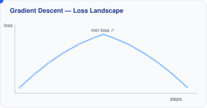
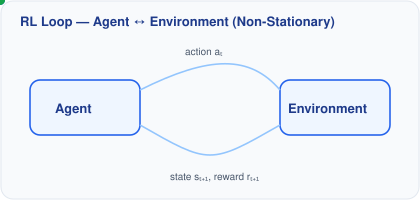
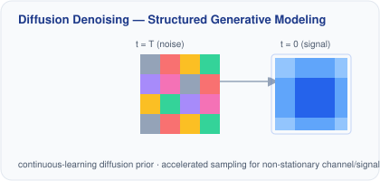

<!--
  Ahsan Bilal — GitHub Profile README
  Design 6 / 6 — "Visual" (violet accent, illustrates the research with custom animated SVG diagrams)
  To use: copy this file's content over the root README.md
  Requires: assets/visuals/*.svg pushed to the `main` branch of AhsanBilal7/AhsanBilal7
  (the diagrams are referenced via raw.githubusercontent.com so they render identically
  whether this file lives at designs/design-visual.md or is copied to the root README.md).
  Note: never pass a raw "&" into desc=/lines=/text= params on capsule-render or
  readme-typing-svg — unescaped in the returned SVG, it corrupts the XML. Use "·" instead.
-->

# Ahsan Bilal

<table width="100%">
<tr>
<td width="44%" valign="top">

**👋 Who I Am** 
Ph.D. CS, University of Oklahoma (REAL Lab) · Research Collaborator, Stanford AI Lab (SAIL). Advised by [Dr. Hougen](https://www.cs.ou.edu/~hougen/resume.html), [Prof. Cioffi](https://cioffi-group.stanford.edu/) & [Dr. Fox](https://emilybfox.su.domains/). Prior: ML Engineer @ Cowlar (YC'17).

</td>
<td width="56%" valign="top">

**🧭 Research Keywords** 
LLM Reasoning &nbsp;·&nbsp; Test-Time Compute &nbsp;·&nbsp; Self-Evolving LLMs &nbsp;·&nbsp; Post-Training &nbsp;·&nbsp; KV Cache &nbsp;·&nbsp; Agentic AI
 
**📍 Publishes In** 
       

</td>
</tr>
</table>

🔭 **Now:** Post-training for self-evolving LLMs &nbsp;·&nbsp; KV-cache eviction `ICLR'27` &nbsp;·&nbsp; Adaptive test-time compute `ICML'26` &nbsp;·&nbsp; [full details ↓](#-current-work)

<a href="https://x.com/ahsan_bilal7">X</a> · <a href="https://orcid.org/0009-0002-7044-9316">ORCID</a>

<a href="#-research-focus">Research Focus</a> ·
<a href="#-visualizing-the-research">Visualizing the Research</a> ·
<a href="#-current-work">Current Work</a> ·
<a href="#-selected-publications">Publications</a> ·
<a href="#-honors">Honors</a> ·
<a href="#-toolbox">Toolbox</a> ·
<a href="#-github-stats">Stats</a>

## 🧭 Research Focus

- 🧠 **LLM Reasoning & Test-Time Compute** — verifier/PRM-guided search, scaling inference-time compute
- 🔁 **Post-Training for Self-Evolving LLMs** — Challenger–Solver self-play, minimax-regret (PSRO) environment design, influence-guided RLVR data selection
- 💾 **Efficient Inference & Alignment** — KV-cache eviction/compression, sparse attention, preference optimization
- 🤖 **Agentic & Adaptive AI** — self-evolving multi-agent architectures
- 🎯 **Reinforcement Learning** — reasoning & decision-making in non-stationary environments
- 📡 **Applied Generative ML** — diffusion models for wireless/signal estimation

## 🔬 Visualizing the Research

Hand-built diagrams illustrating the mechanisms behind the work above — not stock clip art.

<table>
<tr>
<td width="50%" valign="top">

<strong>Test-time search</strong> — candidate reasoning trajectories expand from a prompt; a PRM/verifier scores and selects the best path. Basis for <em>What If We Allocate Test-Time Compute Adaptively?</em> (ICML'26) and <em>S³</em> (COLM'26).
</td>
<td width="50%" valign="top">

<strong>Optimization</strong> — gradient descent converging on a loss landscape, with step size shrinking near the minimum. The classical picture underlying preference-optimization work such as <em>Continuous-Utility DPO</em>.
</td>
</tr>
<tr>
<td width="50%" valign="top">

<strong>RL loop</strong> — agent and (non-stationary) environment exchanging actions, states, and rewards. Underlies RL-for-reasoning work and <em>Hierarchical DRL for Spectrum Resource Optimization</em> (AAAI'25).
</td>
<td width="50%" valign="top">

<strong>Diffusion denoising</strong> — a noisy field settling into a coherent signal over reverse-diffusion steps. Basis for <em>Neural Gaussian Radio Fields</em> (KDD'26) and <em>Conditional Prior-Based Channel Estimation</em> (ICASSP'26).
</td>
</tr>
</table>

## 🚧 Current Work

| Project | Where | Details |
|---|---|---|
| **Post-training for self-evolving LLMs** | REAL Lab, OU | Challenger–Solver self-play with minimax-regret (PSRO) environment design over verifiable environments; influence-guided RLVR data selection — *ongoing* |
| **Memory-efficient LLM inference** | REAL Lab, OU | Monte Carlo KV-cache eviction, head-adaptive sparse attention (`ICLR'27`) |
| **Adaptive test-time compute for LLM reasoning** | REAL Lab, OU | Verifier/PRM-guided reasoning, agentic RL controllers — autoregressive (`ICML'26`) & diffusion (`ICLR'27`) LMs |
| **Diffusion-based wireless estimation & nGRF** | Stanford AI Lab | Neural Gaussian Radio Fields, diffusion test-time scaling for channel prediction (`KDD'26`) |
| **Internet of Agents Platform** | Conoid.ai | Decentralized, self-evolving multi-agent platform |
| **Meta-thinking in LLM agents (survey)** | Independent | `EAAI` (under review) |

## 🤝 Contributions

- **Program Committee:** AAAI'27 · VTC2027-Spring (TPC)
- **Peer Review:** ICLR · ICML · NeurIPS · ICASSP · PAKDD · TMLR · IEEE WCM · Springer MT&A · IEEE Access
- **Cross-org research:** co-authored with researchers from **Google DeepMind** and **Meta AI** (`TMLR'26`), alongside Stanford Statistics, University of Glasgow, and NUST-SEECS
- **Teaching:** TA, *CS-1313: Programming for Non-Majors in C*, University of Oklahoma
- **Talks:** *"AI in Healthcare"* — Norman Regional Hospital

## 📚 Selected Publications
30 papers (22 grouped by area + 8 additional) · \*equal contribution · complete, live-updated list → <a href="https://scholar.google.com/citations?user=UxYCwTcAAAAJ">Google Scholar ↗</a>

<strong>LLM Reasoning, Post-Training, Alignment & Efficient Inference (12)</strong>
 

| Publication | Venue |
|---|:---:|
| **[What If We Allocate Test-Time Compute Adaptively?](https://arxiv.org/pdf/2602.01070)** **A. Bilal**\*, [M.A. Mohsin](https://ahmd-mohsin.github.io/)\*, [M. Umer](https://muhd-umer.github.io/), [A. Subhan](https://alisubhan5341.github.io/), [H. Rizwan](https://scholar.google.com/citations?user=yUCtuKQAAAAJ&hl=en), A. Mohsin, D.F. Hougen |  |
| **[Monte Carlo Estimation for KV Cache Eviction](https://arxiv.org/pdf/2610.07643)** **A. Bilal**, [M.A. Mohsin](https://ahmd-mohsin.github.io/), [M. Umer](https://muhd-umer.github.io/), W.H. Raza, A.U. Asad, Y.D. Kwon, M. Valko, D.F. Hougen |  under review |
| **Attend at the Right Resolution: Head-Adaptive Sparse Attention via Query–Key Interaction Structure** W.H. Raza, **A. Bilal**, Y. Shen, R. Hu, X. Fu, Y. Wen |  under review |
| **[S³: Stratified Scaling Search for Test-Time in Diffusion LMs](https://arxiv.org/pdf/2604.06260)** **A. Bilal**\*, [M.A. Mohsin](https://ahmd-mohsin.github.io/)\*, [M. Umer](https://muhd-umer.github.io/), [A. Aali](https://asadaali.com/), M.U. Khanzada, M.U. Rafique, Z. He, [E. Fox](https://emilybfox.su.domains/), D.F. Hougen |  under review |
| **[General Preference Reinforcement Learning](https://arxiv.org/pdf/2605.18721)** [M. Umer](https://muhd-umer.github.io/), [M.A. Mohsin](https://ahmd-mohsin.github.io/), **A. Bilal**, [A. Chaudhry](https://arslan-chaudhry.github.io/), A. Haupt, S. Koyejo, [E. Fox](https://emilybfox.su.domains/), [J.M. Cioffi](https://cioffi-group.stanford.edu/) |  under review |
| **[Epistemic Uncertainty for Test-Time Discovery](https://arxiv.org/pdf/2605.11328)** K. Riaz, [M.A. Mohsin](https://ahmd-mohsin.github.io/), **A. Bilal**, [M. Umer](https://muhd-umer.github.io/), A. Mohsin, A. Riaz, [A. Subhan](https://alisubhan5341.github.io/), [J.M. Cioffi](https://cioffi-group.stanford.edu/) |  under review |
| **[On the Fundamental Limits of LLMs at Scale](https://arxiv.org/pdf/2511.12869)** [M.A. Mohsin](https://ahmd-mohsin.github.io/), [M. Umer](https://muhd-umer.github.io/), **A. Bilal**, Z. Memon, M.I. Qadir, [S. Bhattacharya](https://scholar.google.com/citations?user=xNb5T5IAAAAJ&hl=en), [H. Rizwan](https://scholar.google.com/citations?user=yUCtuKQAAAAJ&hl=en), A.R. Gorle, M.Z. Kazmi, A. Mohsin, [A. Subhan](https://alisubhan5341.github.io/), M.U. Rafique, Z. He, P. Mehta, J. Han, [M.A. Jamshed](https://scholar.google.com/citations?user=at4MvYMAAAAJ&hl=en), D.F. Hougen, [J.M. Cioffi](https://cioffi-group.stanford.edu/) · *incl. researchers from Google DeepMind and Meta AI* |  |
| **[Faithfulness Is Not Free: Auditing Offline KV-Cache Quantization in RAG](https://arxiv.org/pdf/2608.30996)** A.U. Asad\*, **A. Bilal**\*, M. Ali, M. Haseeb, D.F. Hougen |  Workshop |
| **[Refining Over Resampling: Test-Time Self-Correction for LLM Reasoning](https://arxiv.org/pdf/2608.05643)** **A. Bilal**, [M.A. Mohsin](https://ahmd-mohsin.github.io/), [M. Umer](https://muhd-umer.github.io/), L. Trigg, [A. Subhan](https://alisubhan5341.github.io/), M. Ali, D.F. Hougen |  under review |
| **[Pressure, What Pressure? Sycophancy Disentanglement via Reward Decomposition](https://arxiv.org/pdf/2604.05279)** [M.A. Mohsin](https://ahmd-mohsin.github.io/)\*, **A. Bilal**\*, [M. Umer](https://muhd-umer.github.io/), [E. Fox](https://emilybfox.su.domains/) |  under review |
| **[Logic-Level Evaluation of Logical Table-to-Text Generation](https://aclanthology.org/2026.conll-main.41.pdf)** L. Trigg, D.F. Hougen, **A. Bilal** |  |
| **[ITDPDM: Information-Theoretic Discrete Poisson Diffusion Model](https://arxiv.org/pdf/2505.05082)** [S. Bhattacharya](https://scholar.google.com/citations?user=xNb5T5IAAAAJ&hl=en), A.R. Gorle, **A. Bilal**, C. Ding, A.K.S. Yadav, [T. Weissman](https://web.stanford.edu/~tsachy/) |  |

<strong>Wireless, Signal & Generative ML (10)</strong>
 

| Publication | Venue |
|---|:---:|
| **Agentic Continual Adaptation: Enabling Lifelong Learning in Wireless Channel Estimation** **A. Bilal**, [M.A. Mohsin](https://ahmd-mohsin.github.io/), [M. Umer](https://muhd-umer.github.io/), [M.A. Jamshed](https://scholar.google.com/citations?user=at4MvYMAAAAJ&hl=en), A. Mohsin, [J.M. Cioffi](https://cioffi-group.stanford.edu/), D.F. Hougen |  |
| **[Neural Gaussian Radio Fields for Channel Estimation](https://arxiv.org/pdf/2508.11668)** [M. Umer](https://muhd-umer.github.io/)\*, [M.A. Mohsin](https://ahmd-mohsin.github.io/)\*, **A. Bilal**\*, [J.M. Cioffi](https://cioffi-group.stanford.edu/) |  |
| **[Channel Prediction Under Distribution Shift via Continual Learning Regularization](https://arxiv.org/pdf/2509.15192)** [M.A. Mohsin](https://ahmd-mohsin.github.io/), [M. Umer](https://muhd-umer.github.io/), **A. Bilal**, M.I. Qadir, [M.A. Jamshed](https://scholar.google.com/citations?user=at4MvYMAAAAJ&hl=en), D.F. Hougen, [J.M. Cioffi](https://cioffi-group.stanford.edu/) |  |
| **[Conditional Prior-Based Non-Stationary Channel Estimation via Accelerated Diffusion](https://arxiv.org/pdf/2509.15182)** [M.A. Mohsin](https://ahmd-mohsin.github.io/)\*, **A. Bilal**\*, [M. Umer](https://muhd-umer.github.io/), [A. Aali](https://asadaali.com/), [M.A. Jamshed](https://scholar.google.com/citations?user=at4MvYMAAAAJ&hl=en), D.F. Hougen, [J.M. Cioffi](https://cioffi-group.stanford.edu/) |  |
| **[Transformer-Based Sparse CSI Estimation for Non-Stationary Channels](https://arxiv.org/pdf/2511.01333)** [M.A. Mohsin](https://ahmd-mohsin.github.io/), [M. Umer](https://muhd-umer.github.io/), **A. Bilal**, [H. Rizwan](https://scholar.google.com/citations?user=yUCtuKQAAAAJ&hl=en), [S. Bhattacharya](https://scholar.google.com/citations?user=xNb5T5IAAAAJ&hl=en), [M.A. Jamshed](https://scholar.google.com/citations?user=at4MvYMAAAAJ&hl=en), [J.M. Cioffi](https://cioffi-group.stanford.edu/) |  |
| **Canonical Optimization for MIMO MAC Design** [M. Umer](https://muhd-umer.github.io/), [M.A. Mohsin](https://ahmd-mohsin.github.io/), **A. Bilal**, [J.M. Cioffi](https://cioffi-group.stanford.edu/) |  |
| **[RAG with Multi-Modal LLMs for Wireless Environments](https://arxiv.org/pdf/2503.07670)** · [site](https://cioffi-group-stanford.github.io/Websites/RAG_wireless.html) [M.A. Mohsin](https://ahmd-mohsin.github.io/), **A. Bilal**, [S. Bhattacharya](https://scholar.google.com/citations?user=xNb5T5IAAAAJ&hl=en), [J.M. Cioffi](https://cioffi-group.stanford.edu/) |  🏆 Best Paper |
| **Continual Learning for Wireless Channel Prediction** · [site](https://cioffi-group-stanford.github.io/Websites/wireless_continual) [M.A. Mohsin](https://ahmd-mohsin.github.io/), [M. Umer](https://muhd-umer.github.io/), **A. Bilal**, [M.A. Jamshed](https://scholar.google.com/citations?user=at4MvYMAAAAJ&hl=en), [J.M. Cioffi](https://cioffi-group.stanford.edu/) |  Workshop |
| **[Task and Perception-aware Distributed Source Coding for Correlated Speech](https://arxiv.org/pdf/2501.17879)** · [site](https://cioffi-group-stanford.github.io/Websites/task_aware) [S. Bhattacharya](https://scholar.google.com/citations?user=xNb5T5IAAAAJ&hl=en), [M.A. Mohsin](https://ahmd-mohsin.github.io/), **A. Bilal**, [J.M. Cioffi](https://cioffi-group.stanford.edu/) |  Workshop |
| **[Hierarchical DRL for Spectrum Resource Optimization in Terrestrial/Non-Terrestrial Networks](https://arxiv.org/pdf/2501.09212)** · [site](https://cioffi-group-stanford.github.io/Websites/hierarchical_wireless.html) [M.A. Mohsin](https://ahmd-mohsin.github.io/), [H. Rizwan](https://scholar.google.com/citations?user=yUCtuKQAAAAJ&hl=en), [M. Umer](https://muhd-umer.github.io/), [S. Bhattacharya](https://scholar.google.com/citations?user=xNb5T5IAAAAJ&hl=en), **A. Bilal**, [J.M. Cioffi](https://cioffi-group.stanford.edu/) |  Workshop |

<strong>Additional & early-career work (8)</strong>
 

- **[AgentPersonaBench: Benchmarking Persona-Driven User Simulation](https://arxiv.org/pdf/2610.04379v1)** — `arXiv'26` · open-source contribution to [MatrAIx.ai](https://github.com/MatrAIx-ai) J. Huang, Y. Wang, H. Shen, **A. Bilal**, et al. (46 authors)
- **[Adaptive Replay Refinement: Allocating Test-Time Compute Between Revision and Resampling](https://arxiv.org/pdf/2610.28294)** — `arXiv'26` **A. Bilal**, [M.A. Mohsin](https://ahmd-mohsin.github.io/), [M. Umer](https://muhd-umer.github.io/), A. Mohsin, S. Bilal, D.F. Hougen
- **[Meta-Thinking in LLMs via Multi-Agent RL: A Survey](https://arxiv.org/pdf/2504.14520)** · [site](https://cioffi-group-stanford.github.io/Websites/meta_thinking_llms.html) — `EAAI` (under review) **A. Bilal**, [M.A. Mohsin](https://ahmd-mohsin.github.io/), [M. Umer](https://muhd-umer.github.io/), M.A.K. Bangash, [M.A. Jamshed](https://scholar.google.com/citations?user=at4MvYMAAAAJ&hl=en)
- **[6G Twin: Hybrid Gaussian Radio Fields for Channel Estimation and Non-Linear Precoder Design](https://arxiv.org/pdf/2509.18735)** — `arXiv'25` [M.A. Mohsin](https://ahmd-mohsin.github.io/), [M. Umer](https://muhd-umer.github.io/), **A. Bilal**, [M.A. Jamshed](https://scholar.google.com/citations?user=at4MvYMAAAAJ&hl=en), D.F. Hougen, [J.M. Cioffi](https://cioffi-group.stanford.edu/)
- **[LLMs for Explainable AI: A Comprehensive Survey](https://arxiv.org/pdf/2504.00125)** — `arXiv'25` **A. Bilal**, D. Ebert, [B. Lin](https://beiyulincs.github.io/)
- **Abstract — LLM for Explainable AI** — `IEEE DSAA'24` (poster) **A. Bilal**, [B. Lin](https://beiyulincs.github.io/)
- **On Shadow Removal With Boosted Attention in a Vision Transformer** — `Springer ML` (under review) **A. Bilal**, [A. Salman](https://seecs.nust.edu.pk/faculty/ahmad-salman/), [K. Khurshid](https://namal.edu.pk/faculty/profile/150/dr-khawar-khurshid), D.F. Hougen
- **Person Identification using Gait with Fused Graph and 3D-CNN** — `ACM TAIS` (under review) **A. Bilal**, [A. Salman](https://seecs.nust.edu.pk/faculty/ahmad-salman/), [K. Khurshid](https://namal.edu.pk/faculty/profile/150/dr-khawar-khurshid)

## 🏆 Honors

- 🥈 **Silver Reviewer Award** — ICML 2026
- 🎓 **Gallogly College of Engineering Graduate Fellowship** — 2025
- 🥇 **Best Paper Award** — ICC Workshop 2025, Montreal
- 📜 **Honorary Certificate of Appreciation** — IEEE ComSoc Student Competition 2025
- 🥈 **Best Student Presentation Runner-up** — IEEE DSAA'24 Student Forum
- ✈️ **Student Travel Grant** — IEEE DSAA 2024, San Diego
- 🌍 **UGRIP Selection** — MBZUAI, First Cohort

## 🧰 Toolbox

 

 

<strong>ML Techniques:</strong> GRPO · LoRA · ZeRO · Preference Optimization · Test-Time Scaling · LLM Post-Training · Agentic Systems

<strong>Also:</strong> Statistical Learning Theory · Information Theory · Optimization · MLflow · CUDA · Slurm · Cursor · Signal Processing · 5G · Distributed AI Systems

## 📊 GitHub Stats

<picture>
  <source media="(prefers-color-scheme: dark)" srcset="https://github-readme-stats.vercel.app/api?username=AhsanBilal7&show_icons=true&hide_border=true&bg_color=0D1117&title_color=A78BFA&icon_color=A78BFA&text_color=c9d1d9" />
  <source media="(prefers-color-scheme: light)" srcset="https://github-readme-stats.vercel.app/api?username=AhsanBilal7&show_icons=true&hide_border=true&bg_color=ffffff&title_color=7C3AED&icon_color=7C3AED&text_color=24292f" />
  
</picture>
<picture>
  <source media="(prefers-color-scheme: dark)" srcset="https://github-readme-stats.vercel.app/api/top-langs/?username=AhsanBilal7&layout=compact&hide_border=true&bg_color=0D1117&title_color=A78BFA&text_color=c9d1d9" />
  <source media="(prefers-color-scheme: light)" srcset="https://github-readme-stats.vercel.app/api/top-langs/?username=AhsanBilal7&layout=compact&hide_border=true&bg_color=ffffff&title_color=7C3AED&text_color=24292f" />
  
</picture>

---

Open to research collaborations in LLM reasoning, agentic AI, and RL. Reach out via <a href="mailto:ahsan.bilal-1@ou.edu">email</a>.

